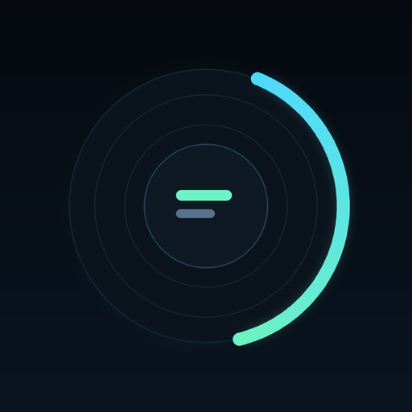

<div align="center">



# 弧光歌词 · ARCLYRIC

**把歌词戴在腕上。**

小米手环（Vela OS）同步歌词播放器 + Android 手机伴侣

<p>
  <a href="https://github.com/wuxiang999">
    
  </a>
  <br>
  <sub>by <a href="https://github.com/wuxiang999">LANHU199</a></sub>
</p>

</div>

---

## 这是什么

手环没有扬声器，歌在手机上放。这个项目把手环变成手机播放器的**遥控器 + 歌词显示屏**：

- 手环显示歌名、歌手、专辑、进度、当前句与下一句歌词；
- 手环可以播放 / 暂停 / 上一首 / 下一首 / ±10 秒；
- 歌词**全自动**：手机端读 MediaSession，本地没有就自动在线匹配带时间轴的 LRC，分包推到手表；
- 手环把收到过的歌词存成本地歌词本，同一首歌离线也能看。

整个链路：

```
┌─────────────────────┐        ┌──────────────┐        ┌──────────────────────┐
│  手环快应用 (.rpk)  │◄──────►│ 小米运动健康  │◄──────►│  Android 伴侣 (.apk) │
│  Vela JS · 6 页     │  interconnect 协议      │  XMS Wearable SDK     │
└─────────────────────┘        └──────────────┘        └──────────┬───────────┘
                                                                  │
                                                     MediaSession │ 在线歌词 / 词库
                                                                  ▼
                                                     ┌──────────────────────┐
                                                     │ QQ音乐 · LRCLIB · 自建│
                                                     └──────────────────────┘
```

## 手环端

适配小米手环 9 Pro：**336×480 像素，`designWidth: 192`，逻辑高度约 274dp**。全部按这个尺寸排版，大字号、加粗、少操作。

| 页面 | 内容 |
|---|---|
| 主页 | 播放器 / 歌词本 / 设置 三个入口 |
| 播放器 | 状态灯、歌名歌手、当前句（最多 3 行）、下一句、进度条、上一首 / 播放 / 下一首、±10 秒 |
| 全屏歌词 | 5 行歌词窗、当前句高亮、上下滑浏览、点句跳转、偏移微调 |
| 歌词本 | 已存歌词分页列表 + 页内全文阅读 |
| 设置 | 连接 / 播放 / 显示 三个标签页，整行胶囊，不用 switch |

交互细节：

- 播放页歌词区可上下滑动浏览，**一滑一句**，停手 6 秒自动回到当前句；
- 轻触歌词 / 歌名进入全屏歌词；
- 所有按钮用图标，不占文字位置；
- 页面固定一屏不滚动，靠分页而不是 `scroll`。

加载动画：这个版本的 Vela CSS **没有 `@keyframes`**，也没有 `@media`，所以动画全部是 JS 定时器切换 class 与宽度档位。播放页和全屏歌词页的进度条显示的是**歌词分包的真实接收进度**（已收到 x/y 包），不是装饰动画。

## 手机端

Kotlin + 原生 View，监听 `MediaSession`，通过 XMS Wearable SDK 和手环通信。

- 顶部渐变主视觉、连接状态指示灯、实时播放信息；
- 歌词库：**手环词库**（手环上真实存着的那几首，可删可重发）与**手机缓存**（歌词源）两个标签页；
- 导入：系统文件选择器批量选 `.lrc`，或粘贴网易云歌单链接批量抓词（单次最多 60 首）；
- 日志：内存环形缓冲 + 实时刷新，不用连 logcat 也能排错。

## 目录

```
src/                      手环端（Vela JS 快应用）
  manifest.json           包名、路由、features、designWidth
  app.ux                  应用入口
  common/scripts/         protocol / lrc / transport / player-state / library / store
  pages/                  boot · player · lyrics · book · reader · settings
  common/images/          图标（只支持 PNG）
android/                  手机端（Kotlin）
  app/src/main/java/com/vela/lyricplayer/
  app/libs/               XMS Wearable SDK
tools/
  build-rpk.sh            手环端唯一出包入口
  gen-icons.py            图标生成
assets/                   512 / 96 图标与品牌图
docs/DESIGN.md            设计系统与排版依据
```

## 构建

### 手环端（RPK）

PC / Mac 上用 AIoT-IDE，或直接：

```bash
npm install
npm run build      # 调试
npm run release    # 正式签名
```

**Termux / aarch64 Android** 上官方 `aiot-toolkit` 2.x 依赖的 `@rspack/binding-android-arm64` 没有发布，跑不起来。项目提供了一条可用路径：

```bash
bash tools/build-rpk.sh debug     # 输出 dist/Arclyric-1.0.1-debug.rpk
bash tools/build-rpk.sh release   # 输出 dist/Arclyric-1.0.1-release.rpk
```

脚本首次运行会把 `aiot-toolkit@1.2.1-alpha.0`（最后一条纯 JS / webpack 工具链）装进 `.tmp/toolchain/`，约 8 分钟，之后复用。它会自动处理三件事：`--no-bin-links`（Android 共享存储不支持符号链接）、`PUPPETEER_SKIP_DOWNLOAD=1`（没有 aarch64 Chromium 包）、构建后还原被编译器清空的 `dist/` 其它产物。

### 手机端（APK）

```bash
cd android
bash build.sh            # 输出 dist/Arclyric-<version>-{debug,release}.apk
```

Gradle 参数、aapt2 覆盖、签名读取方式都在脚本和 `app/build.gradle.kts` 里。

### 签名（必读）

APK 与 RPK **必须同包名、同证书**，否则能发现设备、能建通道，但消息发不出去，日志只会给你 `sendMessage failed`。

- 包名：`com.vela.lyricplayer`（`src/manifest.json` 与 `applicationId` 必须一致）；
- 签名：仓库不含任何 keystore。把 `android/keystore.properties.example` 复制成 `android/keystore.properties` 填自己的值，并把同一套证书配到 `tools/build-rpk.sh` 用的 RPK 签名里。

### 版本号

三处必须同步，否则会出现「改了代码但设备没变化」：

| 文件 | 字段 |
|---|---|
| `package.json` | `version` |
| `src/manifest.json` | `versionName` + `versionCode` |
| `android/app/build.gradle.kts` | `versionName` + `versionCode` |

## 通信协议

UTF-8 JSON，带版本号：

```json
{ "v": 1, "type": "lyrics.chunk", "ts": 1730000000000,
  "payload": { "id": "song-1", "index": 0, "total": 11, "text": "..." } }
```

几条踩出来的规则：

- `connect.send` 的 `data` 必须是对象，统一包成 `{ data: { data: "<json 字符串>" } }`；
- 歌词单包约 100 字，**发一包等一包 ACK**；回执超时就推进，不整首重发。手环通信缓冲很小，一次灌几十条会掉歌词甚至重启；
- 词库上报单包 300 字、间隔约 90ms；
- 手机侧 `sendMessage` 连续失败 3 次判定节点失效，作废并重新发现注册；
- 进度推算必须守卫 `lastPositionUpdateTime in 1..now`，否则 `0` 会被当成时间戳，暂停瞬间跳到结尾。

## 歌词从哪来

全程自动，不需要手动导入：

1. 手机读 MediaSession 拿歌名 / 歌手 / 时长；
2. 先查本地词库；没有就在线匹配：
   - 中文曲：自建聚合接口 → QQ 音乐 → LRCLIB
   - 其它曲：LRCLIB → QQ 音乐 → 自建聚合接口
3. 每个来源按「标题 + 歌手 + 时长」打分，低于阈值直接丢弃，宁缺毋滥；
4. 命中后缓存成本地 `.lrc`，分包推给手环；
5. 手环存进歌词本，下次离线可看。

匹配不到（纯音乐、冷门曲）时手环照常显示歌名与进度，不会卡住；播放器上点「添加歌词」图标可以让手机重试一次。

自建接口地址在 `MusicApi.kt` 与 `OnlineLyrics.kt` 里，换成你自己的服务即可，删掉也不影响回退链路。

## 已知限制

- 只在**小米手环 9 Pro** 上做过真机验证，其它 Vela 设备需要改 `designWidth` 与字号；
- 这个版本的 Vela 不支持 `@media`、`@keyframes`、复合选择器，`list` / `scroll` / `switch` 在 9 Pro 上不可靠，所以列表、分页、开关全部手写；
- `text` 的 `lines` 是 **style 不是 attribute**，写错位置编译能过但不生效；
- 在线歌词依赖第三方接口，接口挂了就只剩本地词库。

## 参考与致谢

- 平台文档：<https://iot.mi.com/vela/quickapp/>
- 排版与防裁切依据：见 [`docs/DESIGN.md`](docs/DESIGN.md)，参考 Compose `LineHeightStyle`、Flutter `TextHeightBehavior` 等公开实现的同类问题结论
- 配套 agent skill：[`vela-quickapp`](https://github.com/wuxiang999/arclyric-vela-skill)

## 许可

[MIT](LICENSE) © 2026 LANHU199
